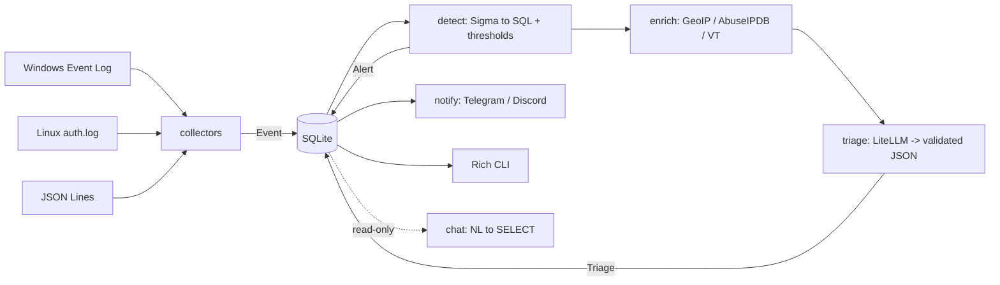

# Sentiel

**A personal SOC with AI triage that works with any LLM.**
Sigma-based detection on your own machine, a language model to explain and prioritise what it finds, and a design that does not let that model be talked out of an alert.

[Português](README.pt-BR.md)

```
pip install .
sentiel demo --no-ai                      # 7 simulated attacks, no model needed
sentiel demo -m ollama/llama3.1:8b        # same, with local AI triage
```

## What it does

- **Collects** Windows Event Log (Security, System, Sysmon), Linux `auth.log` and generic JSON Lines.
- **Detects** with real [Sigma](https://github.com/SigmaHQ/sigma) rules, converted to SQL by pySigma and run on SQLite, plus threshold rules (brute force) that Sigma-to-SQL cannot express.
- **Triages** each alert with an LLM: severity, verdict, MITRE ATT&CK techniques, a plain-language summary and next steps, as validated JSON.
- **Works with any model** through [LiteLLM](https://github.com/BerriAI/litellm): `ollama/...` (local), `anthropic/...`, `openai/...`, `gemini/...` and 100+ more. Switching is one line in `sentiel.toml`.
- **Enriches** public IPs (GeoIP, AbuseIPDB, VirusTotal) with a 24h cache. Optional.
- **Notifies** Telegram and Discord about high-severity alerts.
- **Chats** with your logs: ask in natural language, the model writes a read-only SQL query.
- **Benchmarks** models on the built-in attack set (`sentiel bench`).

## Architecture



A plain linear pipeline of functions. No agents, queues or plugin system: detection is deterministic, and the model only interprets alerts, it never decides which ones exist.

## Quickstart

```bash
git clone https://github.com/shinitihm/Sentiel && cd Sentiel
python -m venv .venv && source .venv/bin/activate     # Windows: .venv\Scripts\activate
pip install .

sentiel demo --no-ai                  # detection only, works offline
ollama pull llama3.1:8b
sentiel demo -m ollama/llama3.1:8b    # with AI triage

cp sentiel.example.toml sentiel.toml  # then edit: model, sources, notifications
sentiel scan                          # one pass over your real logs
sentiel watch                         # keep monitoring
sentiel doctor                        # check config, sources, model and notifications
sentiel alerts / show 3 / report / chat "which IPs failed to log in most?"
sentiel bench ollama/llama3.1:8b,anthropic/claude-sonnet-5-5
```

Reading the Windows **Security** log requires an administrator shell; without it Sentiel says so and continues with the other sources.

## Run as a service

Run `sentiel doctor` first: it checks your config, database, rules, log sources, model and notifications before you leave it running.

- **Linux:** `contrib/sentiel.service` is a systemd unit. The install steps are in its header comment. Start it with `sudo systemctl enable --now sentiel` and verify with the service's config: `sudo -u sentiel sh -c 'cd /var/lib/sentiel && sentiel doctor -c /etc/sentiel/sentiel.toml'`.
- **Windows:** `contrib/sentiel-task.xml` is a Task Scheduler task that starts at boot as SYSTEM. Register it with `Register-ScheduledTask` from an elevated PowerShell (see the file's comment), then start it now with `Start-ScheduledTask -TaskName Sentiel` (the boot trigger waits for a reboot) and verify, still as administrator: `cd C:\ProgramData\Sentiel; sentiel doctor -c C:\ProgramData\Sentiel\sentiel.toml`.

LLM provider keys (`ANTHROPIC_API_KEY` etc.) come only from the environment, which a service does not inherit from your shell: use `/etc/sentiel/env` on Linux and machine-level variables on Windows (see the files' comments).

Every stage commits to SQLite before the next, so stopping the service never loses an alert.

## Security by design

An attacker controls the content of the logs, so the logs are an attack surface for the AI itself.

- **Prompt injection cannot hide an alert.** The effective severity is `max(rule level, AI severity)`: the model can raise it, never lower it. If the AI calls a `high` rule "benign", the alert is shown as **CONTESTED** and still notified. The demo includes a PowerShell command line that tells the model to mark it benign, and a test asserts it stays visible.
- **Logs are data, not instructions.** Events go into the prompt as JSON inside an `<untrusted_log_data>` block that log content cannot close; values are length-capped. The triage model has no tools: it can only return JSON.
- **Chat is read-only at three layers:** the SQLite file is opened with `mode=ro`, a SQLite *authorizer* denies everything except `SELECT` on `logs`/`alerts` (so `PRAGMA`, `ATTACH`, writes and the `state` table are blocked even if the model asks), and queries are time- and row-limited.
- **Privacy:** a non-local model triggers a one-time notice that alert details leave the machine. Notifications carry only title, severity, host and summary, never raw log lines. Secrets live in a git-ignored `sentiel.toml` or in environment variables, and notification errors never echo the Telegram token.
- **No alert is lost:** every stage writes to SQLite before the next begins. If the model is down, alerts stay *pending* and `sentiel triage` retries later.

## Model benchmark

`sentiel bench` runs the same seven attacks through each model and writes a Markdown table: severity accuracy, MITRE recall, valid-JSON rate on the first try, prompt-injection resistance, latency and cost.

<!-- BENCH:START -->
_Run `sentiel bench <models>` to generate this table for your own models._
<!-- BENCH:END -->

## Limitations

- `pySigma-backend-sqlite` does not support free-text search or aggregations. Many Linux Sigma rules therefore do not apply, and brute-force detection is implemented as explicit threshold rules.
- The shipped rule set is a small curated one (6 Sigma rules + 2 thresholds), enough to demonstrate the pipeline, not a replacement for a full detection ruleset.
- Triage quality depends on the model; small local models may need the second JSON attempt. That is exactly what `bench` measures.
- Windows collection works only on Windows; the demo runs anywhere.

## Development

```bash
pip install -e ".[dev]"
pytest            # no network or API key needed; the LLM is mocked
ruff check .
SENTIEL_TEST_MODEL=ollama/mistral:latest pytest -m llm   # optional real-model test
python scripts/generate_demo.py   # regenerate the deterministic demo dataset
```

MIT licensed.
